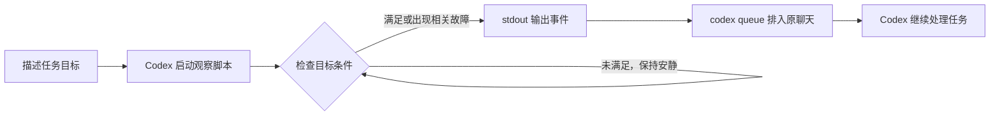

# Codex Monitor

**让 Codex 在后台跟进任务，条件满足后回到原聊天继续处理。**

你描述目标，Codex 选择观察命令、检查间隔和监控期限。等待期间可以继续其他工作；日志或状态出现值得处理的变化时，事件会送回发起聊天，让 agent 接着完成任务。

```text
构建已经在后台运行，日志在 /workspace/app/build.log。
帮我跟进它，出现 BUILD_READY 后检查构建产物；失败就定位原因。
```

灵感来自 [Claude Code Monitor](https://code.claude.com/docs/en/tools-reference#monitor-tool) 的后台脚本事件模式，使用 Node.js、官方 MCP SDK 和本机 `codex queue` 实现。

> 当前版本：0.1.1。面向 Linux / Codex 环境。自动选用由模型决定；事件接续依赖当前 Codex 环境支持 `codex queue`，并保持所属 MCP 连接存活。

## 能做什么

- **跟进长任务**：构建、测试或训练结束后，继续检查结果或处理失败。
- **观察日志和外部状态**：由观察脚本过滤输出，只在目标条件成立或相关状态变化时发送事件。
- **把结果送回原聊天**：切换聊天后，只要原聊天的 MCP 连接仍存活，观察就能继续。
- **由 agent 管理观察周期**：按任务选择期限，完成后停止，仍需等待时续开。

插件附带允许隐式调用的 skill。日常使用可以直接描述任务，不必提到 `monitor`；实际是否启动工具仍取决于模型判断。

## 快速安装

### 环境要求

| 依赖 | 要求 |
| --- | --- |
| 操作系统 | Linux，提供 Bash 和进程组信号支持 |
| Node.js | 22 或更新版本 |
| Codex CLI | 已登录，支持 `plugin`、`mcp` 和 `queue` 子命令；本机验证版本为 0.160.1 |
| 运行环境 | Codex 所在主机的 `PATH` 中可以找到 `node` 和 `codex` |

先确认事件投递命令可用：

```sh
codex queue --help
```

如果当前 CLI 没有 `queue`，该环境无法使用本插件的自动回送链路。项目复用本机 Codex 登录，无需单独配置 OpenAI API key。

### 安装插件

在 Codex 运行的主机上执行；远程 SSH 场景应在远程主机安装：

```sh
git clone https://github.com/yohbii/codex-monitor.git
cd codex-monitor
node scripts/install.mjs
```

仓库已包含打包后的 `dist/server.mjs`，直接安装无需运行 `npm install`。

安装脚本会添加本地 marketplace、安装插件，并通过 `codex mcp add monitor` 注册安装目录中的 MCP 服务器。注册名称为 `monitor`；它让已有聊天也能通过 MCP 配置重载接入工具。

安装后在 Codex 中重载 MCP 配置，或重启 Codex 再使用。若已有监控，重载或重启会中断所属连接上的观察器，需要重新启动观察。

## 使用示例

先独立启动需要跟进的任务，再把目标交给 Codex。例如：

**构建日志**

> 构建已在后台运行，日志是 `/workspace/app/build.log`。出现 `BUILD_READY` 后检查 `dist/`；如果失败，找出失败原因。

**训练完成**

> 跟进当前训练任务，结束后整理最终指标和 checkpoint 路径；中途失败就检查错误日志。

**等待外部条件**

> 等 `/workspace/data/ready.json` 出现后，读取它并执行我们已经确定的数据检查。

Codex 会根据任务编写观察命令，调用 `monitor_start` 后继续其他工作或结束当前轮。事件到达后，再依据原任务处理结果。你也可以直接要求“查看当前监控”或“停止这个观察”。

## 工作原理



观察进程在后台运行。插件按行读取 stdout，将短时间连续产生的事件合并后投递；stderr 保留用于诊断。事件包含监控 ID、描述、工作目录及输出，agent 将其作为原任务的观察数据处理。

**stdout 是触发接口。** 每一行都会进入事件投递流程，因此观察脚本必须自行判断条件。启动消息、初始状态、心跳和诊断应写入 stderr；无变化时不要输出 stdout。进程退出和监控到期也会产生事件。

例如，下面的观察命令等待日志中出现标记，满足后只输出一次并退出：

```sh
while ! grep -qF 'BUILD_READY' build.log 2>/dev/null; do
  sleep 5
done
printf '%s\n' 'BUILD_READY: check the build artifacts'
```

该示例检查文件当前内容，已有标记时会立即触发。如果任务要求只观察启动后的新变化，agent 应在脚本中建立初始基线。文件一直不存在时，它会等待到监控期限结束；如需提前识别构建失败，应同时检查失败标记或任务状态。

## MCP 工具

| 工具 | 作用 |
| --- | --- |
| `monitor_start` | 启动 Bash 观察命令，立即返回监控 ID 和状态 |
| `monitor_list` | 查看当前 MCP 连接拥有的监控、状态、日志路径和投递错误 |
| `monitor_stop` | 按 ID 停止观察进程及其子进程，返回最终状态 |

`monitor_start` 参数：

| 参数 | 必填 | 说明 |
| --- | --- | --- |
| `command` | 是 | Bash 观察命令；仅将需要处理的事件输出到 stdout |
| `cwd` | 是 | 观察命令的绝对工作目录 |
| `description` | 是 | 观察对象及目的 |
| `thread_id` | 是 | 发起聊天的 UUID；agent 在当前聊天中运行 `printenv CODEX_THREAD_ID` 获取 |
| `timeout_seconds` | 否 | 观察期限，默认 300 秒；由 agent 按任务选择 |

`monitor_list` 无参数；`monitor_stop` 接收 `id`。监控列表属于各自的 MCP 连接，并非所有聊天共享的全局列表。

## 运行范围

- **事件接续**：事件通过 `codex queue` 排队，聊天忙碌时等待当前轮结束，再触发后续处理。
- **生命周期**：监控随所属 MCP 连接存活。关闭连接或退出 Codex 会清理观察进程；关闭后不会持续运行。
- **停止范围**：停止监控会终止观察进程组。训练、构建等实际任务应独立启动；放在观察命令里启动的子任务也会随观察一起停止。
- **监控期限**：到期表示观察结束，不代表被观察任务失败。是否续开由 agent 根据原任务判断。
- **投递失败**：插件记录错误并停止仍在运行的观察器，不会自动重试投递。已经进入 Codex 队列的消息不会因停止监控而撤回。

## 排查问题

| 现象 | 检查方向 |
| --- | --- |
| Codex 没有主动开始观察 | 确认插件已安装、当前聊天能调用 `monitor_start`，并且任务明确需要后续跟进；自动选用仍取决于模型 |
| 报 `unknown MCP server 'monitor'` | 确认安装脚本成功完成 MCP 注册，随后重载 MCP 配置或重启 Codex |
| 启动后立刻收到事件 | 检查 stdout 是否输出了启动信息、条件是否原本就成立，或观察进程是否立即退出 |
| 条件满足却没有事件 | 查看观察进程状态、stdout 缓冲和 `delivery_error`；确认 `codex queue` 可用 |
| 其他聊天里看不到监控 | 在启动它的聊天中检查；`monitor_list` 只列出当前连接拥有的监控 |

运行记录保存在源码目录之外：

```text
${XDG_STATE_HOME:-~/.local/state}/codex-monitor/<thread>/<monitor>/
├── metadata.json   # 观察命令、目录、描述和期限
├── stdout.log      # 观察输出（有输出时生成）
├── stderr.log      # 诊断输出（有输出时生成）
├── delivery.jsonl  # 投递成功或失败记录
└── result.json     # 观察进程结束时的状态
```

`monitor_list` 会返回实际日志目录、stderr 尾部和投递错误。投递是否成功以 `delivery.jsonl` 为准；它记录排队结果，后续任务是否完成需看原聊天中的处理结果。

## 开发

```sh
npm ci
npm test
npm run build
npm run install:codex
```

修改源码后重新构建并安装，再重载 MCP 配置。直接修改安装缓存会被后续安装覆盖。

```text
src/                           MCP 工具与观察进程管理
dist/server.mjs                包含依赖的可运行构建产物
skills/monitor/                agent 自动选用与事件处理指引
scripts/install.mjs            本地安装及 MCP 注册
.agents/plugins/marketplace.json 本地 marketplace 定义
plugin.json                    插件元数据
mcp.json                       插件 MCP 启动配置
test/monitor.test.js            核心行为测试
```

现有测试覆盖输出与失败退出、静默等待、到期通知、停止范围、投递失败及连接关闭清理。Linux / Codex 0.160.1 环境中已实测原生 MCP 调用、条件成立前静默、条件成立后回送原聊天并自动接续。不同 Codex 环境仍需具备上述 CLI 能力；自然语言自动选用不作每次必然触发的保证。
